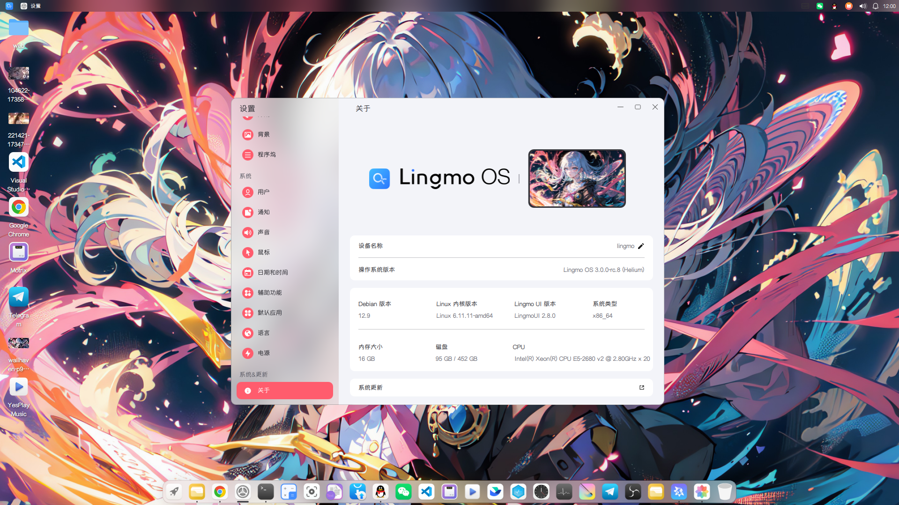

# Lingmo OS

The source tree of Lingmo OS.

This repository provides a unified source tree for Lingmo OS, bringing together its core components, desktop environment, applications, system services, and related infrastructure.

## Source Synchronization

This repository is automatically synchronized on a daily basis with the individual source repositories maintained by the LingmoOS organization.

It includes all configured LingmoOS source components, **excluding the Linux Kernel source code**, which is maintained and synchronized separately.

## Repository Structure

| Directory | Description |
|---|---|
| `apps/` | Desktop applications |
| `base/` | Base system components |
| `boot/` | Boot configuration and themes |
| `core/` | System core |
| `fm/` | File manager |
| `framework/` | Desktop framework |
| `lib/` | Shared libraries |
| `live/` | Live system components |
| `meta/` | Package and system metadata |
| `platform/` | Platform infrastructure |
| `sdk/` | Software development kit |
| `services/` | System services |
| `shell/` | Desktop shell |
| `shellExtra/` | Desktop assets and resources |
| `system/` | System-level components |
| `third-party/` | Third-party dependencies |
| `utils/` | Utilities and build tools |
| `vendor/` | Hardware and vendor integrations |
| `xdg/` | XDG integration |

## Linux Kernel

The Linux Kernel is maintained separately and is not included in this repository's daily synchronization.

Refer to the [LingmoOS Manifest](https://github.com/LingmoOS/manifest) repository for kernel source synchronization configuration.

## Related Repositories

- [LingmoOS Organization](https://github.com/LingmoOS)
- [Manifest](https://github.com/LingmoOS/manifest)

## License

Individual components retain their respective licenses. Please refer to the corresponding source repositories for licensing information.

## ❤️ Support LingmoOS

If you find the project useful, you can support it via a
**one-time contribution**:

👉 Patreon: https://www.patreon.com/LingmoLinux

Your support helps keep LingmoOS moving forward.
Thank you for supporting open-source ❤️
